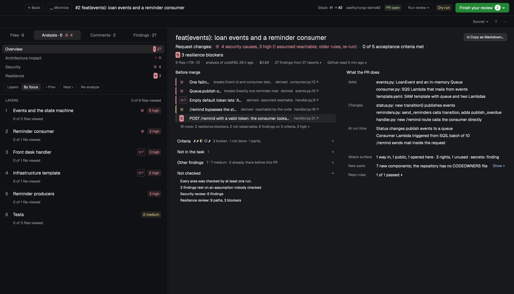
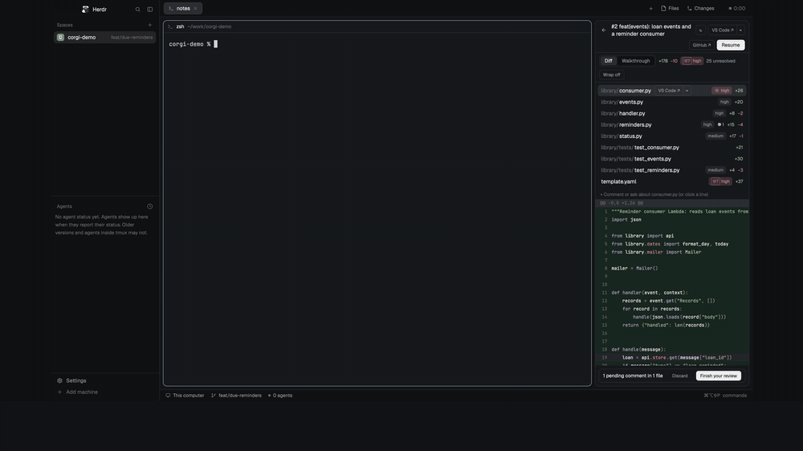
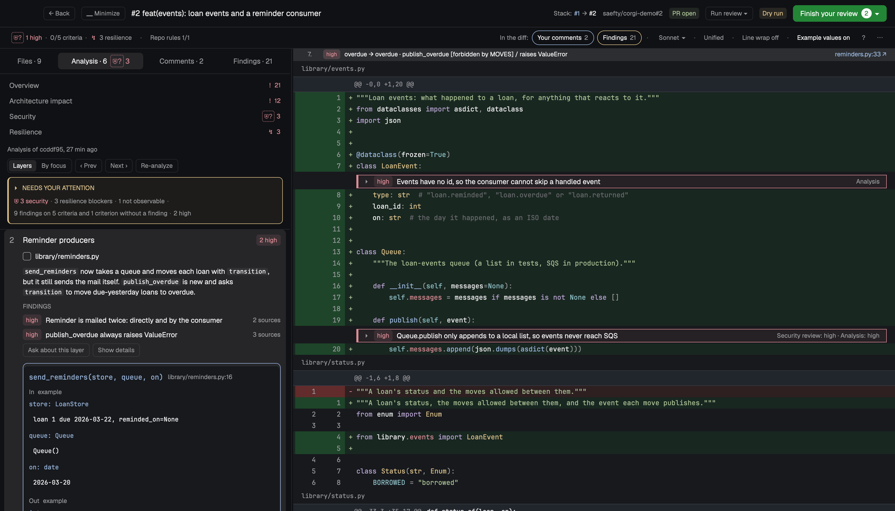
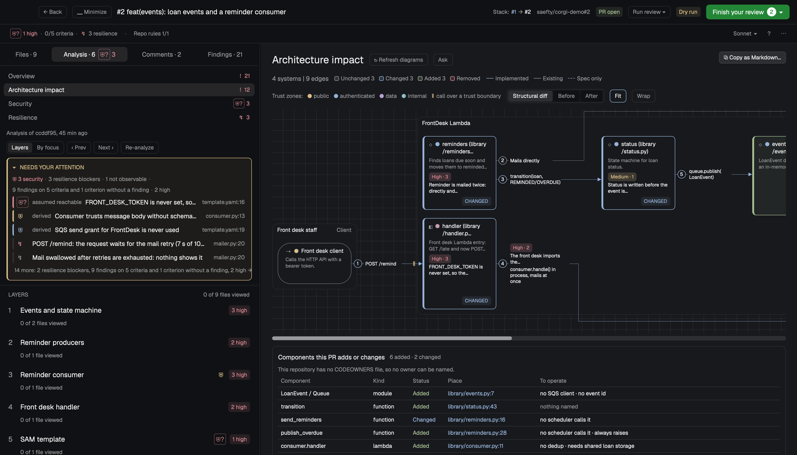
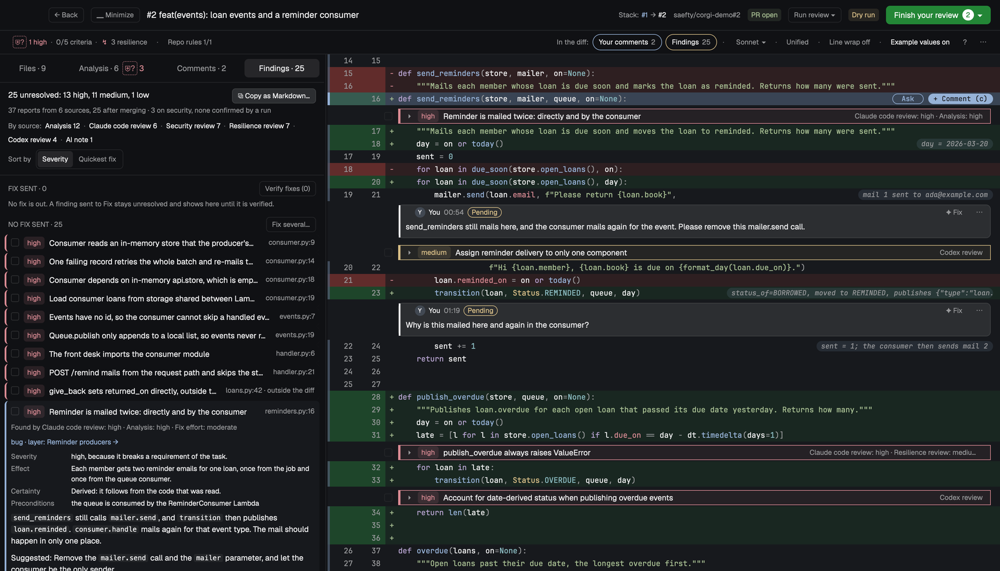
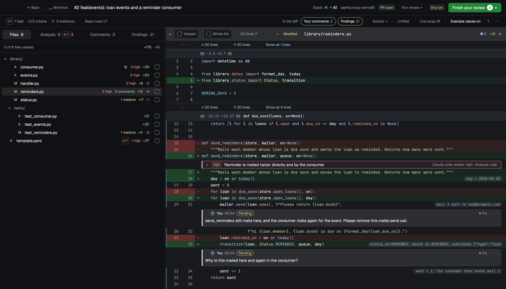
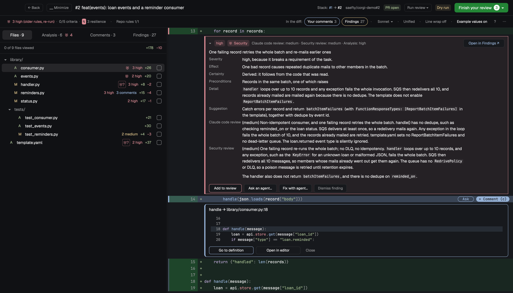
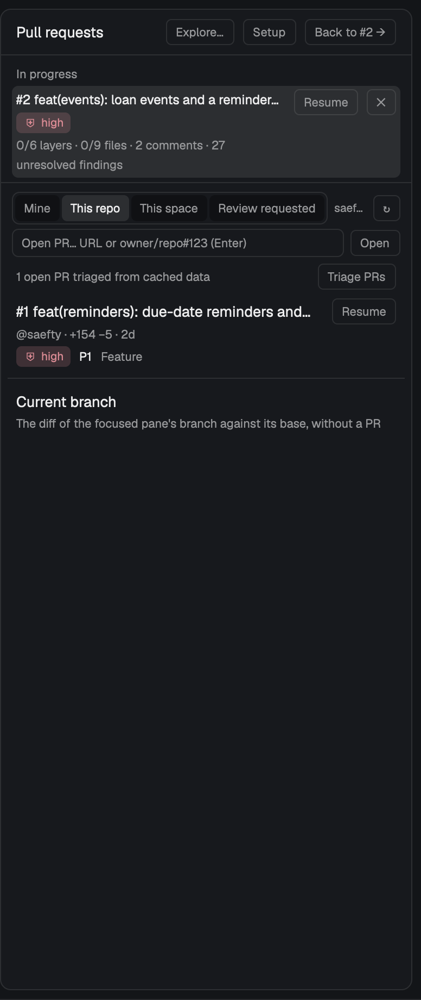
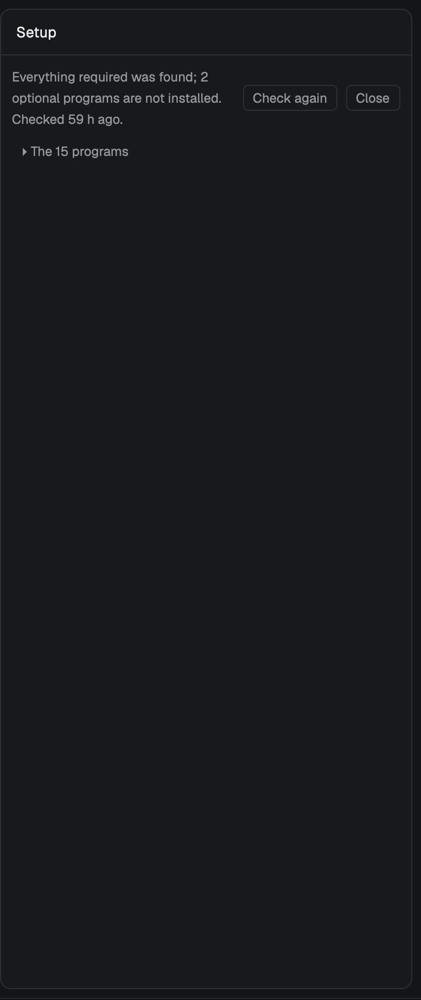
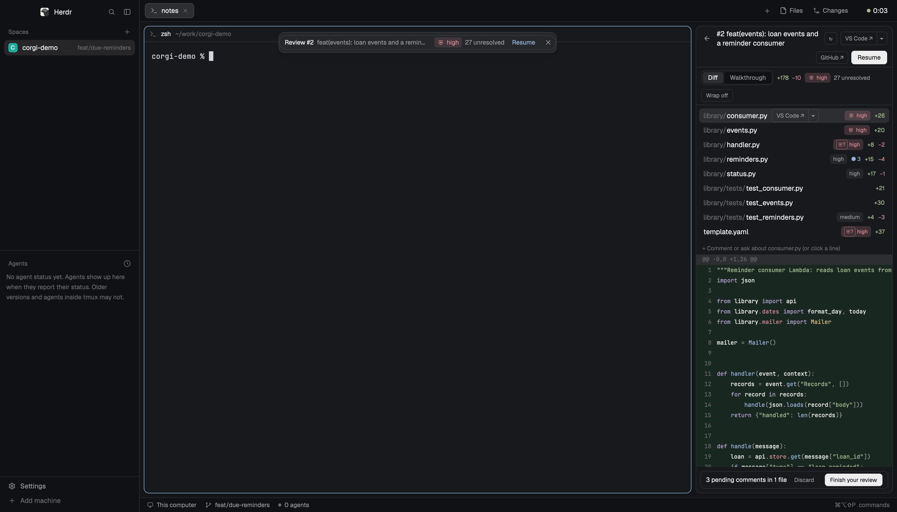

# Corgi · PR review for Herdr

<h3 align="center">AI-guided pull request review for Herdr: the change as a story, risk first, with an architecture map, a blast radius and debugger-style sample values in the diff.</h3>

<p align="center"></p>

<p align="center"><sub>✓&nbsp;Free,&nbsp;MIT &nbsp;·&nbsp; ✓&nbsp;Runs&nbsp;locally &nbsp;·&nbsp; ✓&nbsp;herdr-app&nbsp;0.1.16+</sub></p>

Part of [Corgi](https://github.com/saefty/herdr-corgi), a set of Herdr mods that plug into each other.

A Herdr mod for reviewing pull requests next to your agents. A side panel shows the focused branch's diff (or any
PR), lets you comment on lines and send the comments to the agent that wrote the code. A full-window review
layout adds an AI analysis that walks you through the PR by risk and layer, reviewers (Claude code review,
security review, optionally Codex) whose findings you can send to the agent to fix and then verify, an
architecture picture, a security blast radius, CI checks, related PRs, and go-to-definition in the diff. You comment
as on GitHub: a comment box under the line, pending comments as threads, and "Finish your review" posts one GitHub
review (Comment, Approve or Request changes) or sends it to the agent session.



| | |
|---|---|
|  |  |
|  |  |
|  |  |
|  |  |
|  | |

The screenshots show an invented demo project (`demo/`), not a real repository.

## Highlights

**The changeset, visualized.** The PR is grouped into layers by intent (data model, API, UI, tests) and ordered by
risk or by reading order. Each layer says why it matters, which files it touches and what to check, with one or more
small diagrams of its flow, sequence or state machine. A state machine is drawn top to bottom, either as an entity's
lifecycle or as a Step Functions workflow.


**Architecture impact.** A map of the components the PR adds, changes or removes and how they connect, with a
Before / After toggle. Calls point left to right. Each connection gets its own lane and a numbered label. A call that
would skip a column becomes a short chip that names the target. Click a card to dim everything it doesn't touch.
Elements that only the PR description or ticket mentions, and that the diff doesn't contain, show as dashed "spec".
↻ Refresh diagrams redraws the pictures for today's diff without re-running the whole analysis.

Below the map, **Impact** shows the functions and classes the PR changes and who calls them, from the language
servers and without a model: each caller is marked as changed in this PR, in the diff with its call untouched, or
not in this PR, and a caller that still calls a changed signature the old way stands out. Tests are counted apart.

When the PR changes a database schema, **Schema changes** shows the tables before and after as cards with their
changed columns, keys and relations, and lists what may be risky for data that is in use, such as a dropped column,
`NOT NULL` without a default or an index built without `CONCURRENTLY`. It is read from the SQL migrations, Alembic
revisions and Prisma schema in the diff, without a model and without asking a database. Django and Rails
migrations, Liquibase changelogs in XML or YAML and JPA entities are not read yet; the section names them when it
shows.


**Sample values in the diff, like a debugger.** Next to the changed lines you see example inputs and results:
what a function gets, what it returns, which branch runs. You read the behavior instead of guessing it.


**Ask the diagram, and look inside a card.** Ask about the architecture, a card, a layer or the lines you selected:
the answer lights up the cards and connections it is about, links its file:line evidence, and stays in a short thread
per PR in a drawer at the right edge. Pin an answer and it stays on the picture as a private note. Show details opens
a card or a layer from the inside: its functions and how data flows through them, with sample values, and a
breadcrumb to go deeper or back.

**Explore code you don't know.** No PR needed: pick a repo, type a topic ("How does the reminder job get scheduled
and sent?") and get the same walkthrough as for a PR: the question, how it works, layers in reading order, the
architecture and sample values, each with file:line, and the cited files in a read-only view with go-to-definition.

**Comments that keep going.** Sent and posted comments stay under their lines as threads. The agent answers each one
in place, GitHub replies show up there too, and Fix hands one comment, or all selected ones, to a sub-agent that works
in its own worktree. When done it hands its commit to the PR's agent, which cherry-picks it, runs the tests and
pushes; Apply to PR brings it over yourself when there is no live PR agent.

**Security blast radius.** The changed parts in the middle, the existing code that calls into them on the left and
what they call on the right, each with the reason it matters.


## Use cases

- **Your agent opened a PR.** It shows up in the panel with the session that made it. You read the diff, comment on
  lines, and send the comments back to that agent, which picks up where it left off.
- **A colleague asked you for a review.** Pick it under *Review requested*, open it full size, and let the AI walk
  you through it: what the PR wants, how behaviour changes, which layer to read first and why. Comment on lines
  and post all comments as one GitHub review with Comment, Approve or Request changes.
- **A big PR lands on a Friday.** The overview gives you merge risk, review effort, blockers and failed checks
  before you open a file. The layers group 40 files into five steps you can tick off.
- **The author pushed again.** You see only what changed since your last review, and one click re-analyses just
  that part.
- **You want a second opinion.** Run a Claude code review, a security review or Codex. Findings land on their lines,
  one per defect whoever found it; send one to the agent with *Fix* (it stays unresolved as "Fix sent"), then *Verify*
  checks the new commit: only that makes it "Fixed".
- **You don't know the codebase.** Hover a name or ⌘-click it to read its definition, see example values next to
  the changed lines, and look at the architecture picture to see which services the change touches.

## Features

- Panel: PRs from your sessions, the repo you're in, or review requests, with a one-line triage per PR.
- Review layout: overview (intent, behaviour, risk, effort, blockers, pre-merge checks), layers in risk or reading
  order with check questions, an architecture impact diagram, a security blast radius, and related PRs.
- Diff: syntax highlighting, go-to-definition through real language servers, inline example values, collapsed
  context you can open.
- Comments as on GitHub: click a line number (shift-click for a range) or press `c` for a comment box under the
  line, with Suggestion, Post now to GitHub (or Send to agent…) and Start a review. Comments are compact cards;
  sent and posted ones stay as threads with the agent's replies (by comment id) and GitHub's, and survive restarts.
- A Comments tab lists every comment by file with its state and replies; Show: Yours · Findings · Agents · GitHub ·
  Notes in the bar is the one filter for what appears in the diff and in that list.
- Finish your review: a summary, Comment / Approve / Request changes, and every item that would go out with a tick and
  inline edit. Only what is ticked is posted; the line above Submit names the gh login and the PR. AI suggestions,
  findings and notes never go out unless you add them as comments.
- Nothing is typed into an agent's session without a preview of the exact, editable text.
- Fix: one comment, the selected ones, or a finding go to a sub-agent (default) in its own worktree on a fix branch,
  or to the main agent. The sub-agent never pushes: the PR's agent gets a note when it starts and, when it is done,
  its commit to cherry-pick, test and push. Apply to PR (secondary) cherry-picks onto a clean checkout without pushing.
- Ask about this, pinned notes and Show details (a card or a layer from the inside), as described above.
- Explore a topic in existing code without a PR (the panel, the review's ⋯ menu, or `pr-review.explore`).
- Big PRs: the analysis gets every hunk, inlines what fits, reads the rest itself and splits into passes when it has
  to; it says what it read in detail and what it only skimmed.
- Reviewers: Claude code review, security review, Codex (when installed), each finding with Discuss, Fix and Verify.
- One finding per defect: the reviewers' findings, the analysis' and AI suggestions on the same file and line are one
  entry with its sources ("Security review: high · Analysis: medium"), the highest severity counts. A suggestion alone
  on its line is a one-line note, not counted. States: Unresolved, Fix sent (still unresolved, with agent, branch,
  commit and report), Fixed (after a passed verification), Dismissed. Every view shows the same count.
- Incremental: "since your last review" view and analysis.
- A resizable layers column (drag the divider, double-click for the default width).
- Model per review (Sonnet or Opus; Haiku only for text: triage and reshaping a reviewer's prose); LLM calls only on click.
- Restricted Mode for other people's code (see below).
- Works with other mods: separate setups (accounts, clone folders), the Go to box and the chat bar.

## Works with

PR review, [Go to](https://github.com/saefty/herdr-corgi-goto) and the [chat bar](https://github.com/saefty/herdr-corgi-chatbar) each work alone. Installed together, they plug into each other:

- With **Go to** (⌘⇧P), paste a PR link or type `repo#123` and pick "Review PR"; reviews you started are searchable as "Resume review".
- With the **chat bar**, Discuss opens the agent's chat bubble so you can follow its answer without leaving the review.
- With **[Worktrees](https://github.com/saefty/herdr-corgi-worktrees)**, each checkout and branch there shows the mark of its PR from the lists this panel already has, and a click on the mark picks that PR here.
- **Separate setups**, like work and personal: a small mod of your own can give each its accounts, clone folder and environment, and the panel shows each setup's PRs with its own tag.

## What's in here

- `mods/pr-review/`: the mod (the panel, and the review layout's two parts). `review-layout.json` is the review
  layout; the mod copies it to `layouts/review.json` the first time you open a review.
- `RECIPE.md`: the brief to build it from scratch.

## Requirements

A mod can't install programs. The panel's **Setup** (PRs ▾ → Setup, and by itself on first open when something
required is missing) checks each one, says what it enables, and opens a terminal with the install command typed
in but not run.

| Program | Needed for | macOS | Linux |
|---|---|---|---|
| `git` (2.46 or later for the full push lock) | diffs, checkouts, the push lock of fix and verify agents | `brew install git` | `sudo apt install git` |
| `gh` (logged in) | PR lists, diffs, CI checks, clones | `brew install gh`, `gh auth login` | `sudo apt install gh` |
| `claude` (logged in) | the AI analysis, reviewers, triage, fix checks | `npm install -g @anthropic-ai/claude-code` | same |
| `python3` | the helper scripts (standard library only) | `brew install python` | `sudo apt install python3` |
| `codex` (optional, with permission profiles; checked with 0.164) | the Codex reviewer, offered only when installed | `npm install -g @openai/codex` | same |
| `bwrap` (optional, Linux only) | the sandbox a probe's script runs in | built in (`sandbox-exec`) | `sudo apt install bubblewrap` |
| `acli` (optional) | the Jira ticket a PR names, in the task check | `brew tap atlassian/homebrew-acli && brew install acli` | see Atlassian's docs |
| an editor (optional): VS Code, IntelliJ IDEA, Cursor or Zed | "Open in VS Code" on a file's head, a definition, a card's place in the code and a PR's checkout | `brew install --cask visual-studio-code`, or `brew install --cask intellij-idea-ce` | `sudo snap install code --classic`, or `sudo snap install intellij-idea-community --classic` |

**Open in your editor.** A file's head in the diff, the file and definition view, the panel and the cards that
name a place in the code carry a link "VS Code ↗" or "IntelliJ ↗": it opens that file at its line in the checkout the
review made for the PR. A click starts one process and changes nothing in the checkout. On macOS the app is enough
(the link goes through `open` and the editor's own URL, `vscode://file/…` or `idea://open?file=…`); on Linux the
`code` or `idea` command is used. Java, Kotlin and Gradle files open in IntelliJ IDEA and the rest in VS Code; a
folder goes by the kind of project. The ▾ next to the link picks another editor for that project, and the pick is
shared with the other Corgi mods. For a PR from someone else that you have not trusted, only single files are
opened, never the folder and never a build or workspace file, because an editor can run a project's code when it
opens those. More editors: `"editors": [{"id", "name", "folder": [argv…], "file": [argv…]}]` in
`pr-review.config.json`, with `{dir}`, `{file}` and `{line}`. With `"dryRun": true`, or with a file `editor.dry-run` in the
Herdr home, no editor is started: the click says what it would have run.

**Drag a file onto a terminal.** A file's name in the big diff's file head and a file's row in the panel can be
dragged onto a terminal: Herdr types the file's path in the local checkout there, quoted and without Enter. A click
does what it did before. Nothing drags without a local checkout, for a file the PR deletes, or for a symlink the PR
adds or changes.

Language servers are optional. Each turns on go-to-definition, hover and the Architecture page's Impact picture
(who calls what the PR changes) for its language. Without one, those three are off for that language and nothing
else changes; the Impact section then names the missing server and its install command. Setup checks them too.
Impact needs no server for Terraform, CloudFormation or SAM: those files are in "Infrastructure changes", read from
the diff.

| Language | Language server | macOS | Linux |
|---|---|---|---|
| TypeScript, JavaScript | `typescript-language-server` + `tsc` | `npm install -g typescript-language-server typescript` | same |
| Python | `pyright-langserver` | `npm install -g pyright` | same |
| Go | `gopls` | `brew install gopls` | `go install golang.org/x/tools/gopls@latest` |
| Rust | `rust-analyzer` (only for PRs you trust) | `rustup component add rust-analyzer` | same |
| Java | `jdtls` | `brew install jdtls` | see the Eclipse JDT LS docs |
| Terraform (go-to-definition and hover only) | `terraform-ls` | `brew install hashicorp/tap/terraform-ls` | see HashiCorp's docs |
| C, C++ | `clangd` | `xcode-select --install` | `sudo apt install clangd` |

The reviewers use Claude Code's `/security-review` and a `/code-review` command; without the command in your
Claude setup the same review runs as a plain prompt.

What happens without them:

- `git` older than 2.46 cannot turn off a remote's own push URL (`remote.<name>.pushurl`). pr-review asks git before
  a fix or verify agent starts; in a clone with such a remote the agent does not start and the note says why.
- A `codex` without permission profiles (`default_permissions`), or one set up only in `~/.codex/config.toml`
  (another provider, the login in the keyring), fails the Codex review with Codex's own error. It never falls back
  to a run that reads more.
- Without a sandbox (`bwrap` missing on Linux, or not allowed to make its namespaces) every probe asks first and
  says that its script can read and change your files and reach the network.

## Install in three steps

<table>
<tr>
<td align="center" valign="top" width="33%"><h3>1</h3><b>Add the mod</b><br /><sub>With <a href="https://github.com/saefty/herdr-corgi">Corgi</a>: <code>corgi enable pr-review</code>. By hand: copy <code>mods/pr-review</code> to <code>~/.config/herdr-app/mods/</code>. There are no keys to merge.</sub></td>
<td align="center" valign="top" width="33%"><h3>2</h3><b>Check it</b><br /><sub>Corgi does this for you. By hand: <code>herdr-app check ~/.config/herdr-app/mods/pr-review</code>.</sub></td>
<td align="center" valign="top" width="33%"><h3>3</h3><b>Open a PR</b><br /><sub>The panel docks on the right. Its Setup says which programs are missing; then pick a PR and press Review.</sub></td>
</tr>
</table>

Or tell your agent: `Read ~/.config/herdr-app/AGENTS.md, then add this mod: https://github.com/saefty/herdr-corgi-pr-review/tree/main`

By hand, step by step: copy `mods/pr-review` to `~/.config/herdr-app/mods/`, then run
`herdr-app check ~/.config/herdr-app/mods/pr-review`.
The panel docks on the right the first time Herdr sees it. The review layout appears on first use: the first
"Review" click writes it to `layouts/review.json` (or `layouts/pr-review.json` when you already have a different
layout named `review`). It never overwrites a file you have.

It runs programs (`git`, `gh`, `claude`, `python3`, language servers), reaches GitHub through `gh` (it posts only
when you click Submit review or Add single comment), and reads your
Claude session transcripts (`~/.claude/projects`) to list PRs your sessions created. LLM calls only happen when you
click (Analyze, a reviewer, Triage, Verify fixes). Its data lives in `~/.config/herdr-app/pr-data/`.

## Settings

Optional, in `~/.config/herdr-app/pr-review.config.json`:

```json
{ "language": "English", "cloneRoot": "~/code", "globalRules": "PR titles follow Conventional Commits.", "ledger": null, "dryRun": false }
```

`language` is what the AI writes in; `cloneRoot` is the folder where a PR's repository is looked for and, when you
click "Clone to …", cloned into (default `~/code`; with `"cloneRoot": "~/Work/Claude"` a clone goes to
`~/Work/Claude/<repo>`); `globalRules` are conventions every PR is checked against; `ledger` is a folder for a JSONL
usage ledger of every LLM call; `dryRun` makes "Submit review" write the GitHub payload to
`pr-data/review-dry-run.json` instead of posting it.

### Where checkouts go

The mod makes no folder inside your repositories. The checkout of the PR head that a review reads, and the checkout
of every fix, verify and probe agent, are git worktrees in Herdr's folder for worktrees, the one its own New worktree
uses: `<worktrees.directory>/<repo>/<branch>`, with a `-` for every `/` in the branch name. The review's checkout
sits on no branch and is called `pr-review`. The folder is set in Herdr's `settings.json` and defaults to
`~/.herdr/worktrees`:

```json
{ "worktrees": { "directory": "~/Developer/worktrees" } }
```

A review checkout that an earlier version made at `<clone>/.worktrees/review` is still used and is never removed by
the mod. To have that repository's review checkout in the folder above, remove the old one yourself:
`git -C <clone> worktree remove .worktrees/review`.

## Customize

Without touching code:

- **What the AI writes and checks:** `language`, `globalRules` (conventions every PR is checked against) and the
  other keys in `pr-review.config.json` (above).
- **Which model:** Sonnet or Opus, picked per review in the review layout. Fix and Ask agents run on it too. Haiku is
  used only for text (PR triage, turning a reviewer's prose into findings); a stored Haiku pick becomes Sonnet.
- **The review layout:** `layouts/review.json` is yours once it is written. Move, resize or remove its blocks; the
  mod never overwrites it.
- **Your own code review:** with a `/code-review` command in your Claude setup, the Claude reviewer uses it.
- **Separate setups** (accounts, clone folders, environment) from a small mod of your own; see Plug-ins.

Changed the code itself? Your edits survive `corgi update`: Corgi merges your version, the old release and the new
one. `corgi diff pr-review` shows what you changed, and `corgi resolve pr-review` helps when an update and your edit
touch the same lines.

## Plug-ins

Other mods can add setups (groups of PRs with their own tag, environment, clone folder and view filter), show the
review list somewhere else, and work with Go to and a chat bar. For mod authors, the details are in
[PROVIDERS.md](mods/pr-review/PROVIDERS.md).

## Demo

`sh demo/setup.sh` builds an invented repo (`acme/bookshelf`, PR #7 "feat(loans): add due-date reminders") with a
local stand-in for its GitHub remote, and a separate Herdr home in `demo/home` whose pr-review data is seeded from
`demo/fixtures/` (the analysis, two findings, related PRs and checks, PR lists, triage). Open a second Herdr window
on it with `HERDR_APP_HOME="$PWD/demo/home"`, add a space in `demo/bookshelf` there, and switch it to the `review`
(or `demo-panel`) layout: everything shows without LLM calls, and GitHub is only asked when a seeded PR list is
older than 3 minutes (↻). The commands `pr-review.page:arch`, `pr-review.step:1`,
`pr-review.def:<path>:<line>:<name>`, `pr-review.source:repo` and `pr-review.setup` drive it from
`herdr-app do`, and `pr-review.comment:<path>:<line>` and `pr-review.finish` open the comment box and the
Finish-your-review popover. The demo config sets `"dryRun": true`, so Submit review posts nothing.

## Tests

`cd mods/pr-review && for f in test_*.mjs; do node $f; done && for f in test_*.py; do python3 $f; done`
(no network; `LIVE=1 node test_defs.mjs` also asks pyright).

## Restricted Mode

Language servers can run code from the repo they index: Gradle and Maven build scripts, Rust build scripts and proc
macros, a toolchain or cargo config, a TypeScript copy in node_modules. pr-review trusts your own branches, PRs from
your sessions and PRs you authored. For anyone else's PR it asks first, as VS Code does when you open a folder:

- **Trust this PR** or **Trust all PRs in owner/repo**: language servers run as usual.
- **Stay in Restricted Mode**: Java skips the build import, TypeScript uses your global install, Go downloads nothing
  and skips cgo, and rust-analyzer doesn't start. Go-to-definition finds less. The Codex review asks once before
  it runs. The diff, comments and reviews, the Claude reviewers and the AI analysis work the same.

The header shows **Restricted Mode · Trust** until you trust the PR.

## What the runs may do

Every run reads code and text from the PR, which may carry instructions for a model. So each one is fenced, and the
popups say the same as this list:

- **Claude reviewers and the AI analysis** read the PR checkout and its git history, write nothing and have no
  network and no MCP servers. They get an allowlist of your environment: what a CLI needs to start and the account's
  own login, no other key, token, password or agent socket.
- **Codex review** reads the PR checkout and its clone's `.git` folder, nothing else on the machine. It writes
  nothing. Codex itself reaches its provider (OpenAI, a second provider); the commands it runs reach nothing. MCP
  servers, hooks, plugins, apps and Codex config, yours and the PR's, are off.
- **Fix and verify agents** work in their own worktree. Their git cannot push: every remote, also one with a push
  URL of its own, and every URL given to `git push` lead to an address no git can open, and `git push`,
  `git send-pack` and `gh pr create` are denied. Not covered: what an agent sets against it on purpose (a push URL
  of its own, a cleared environment), `git send-pack` inside a script, or a push through the GitHub API.
- **Probes**: an agent without a shell writes one script; the review runs it in a sandbox with no network, nothing
  from your home and writes only to a temporary folder. A link or a script the PR checked in at the agent's paths
  is removed before the agent starts.
